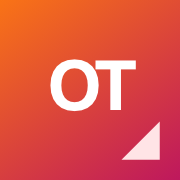
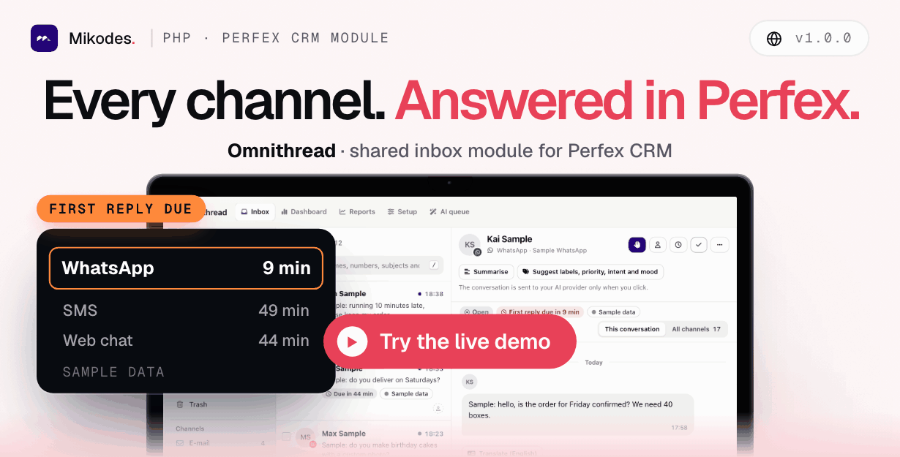
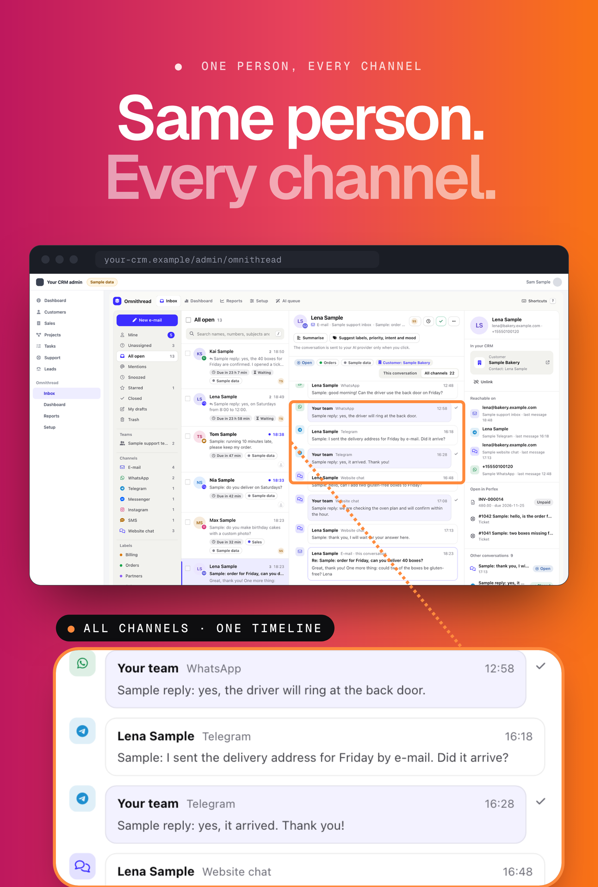
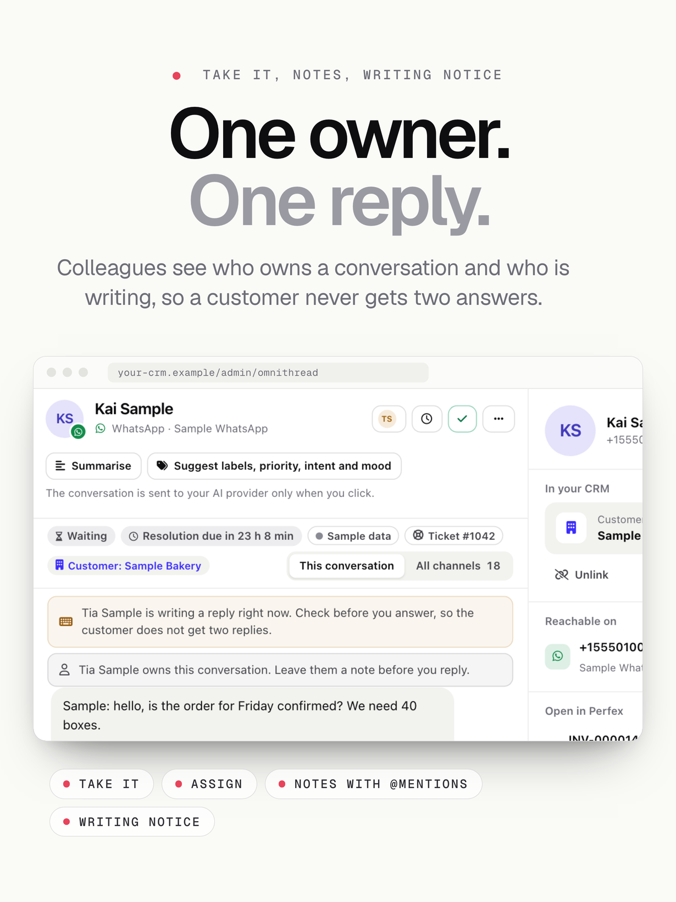
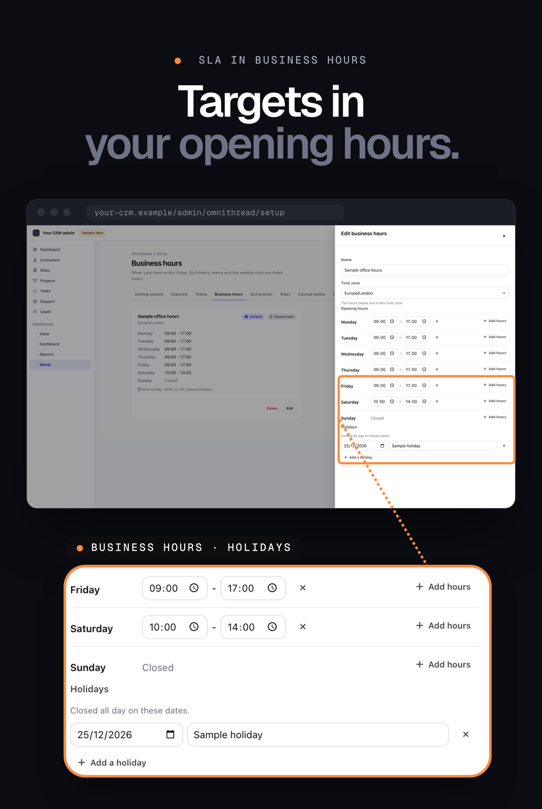
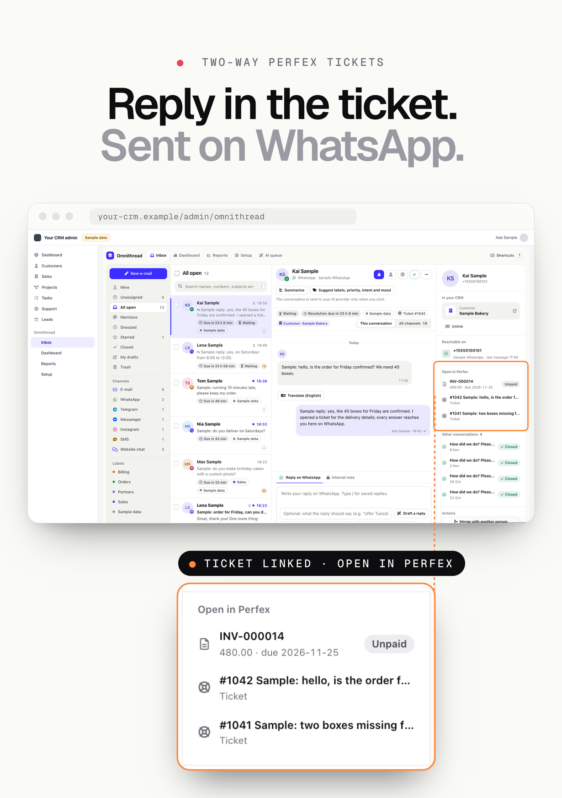
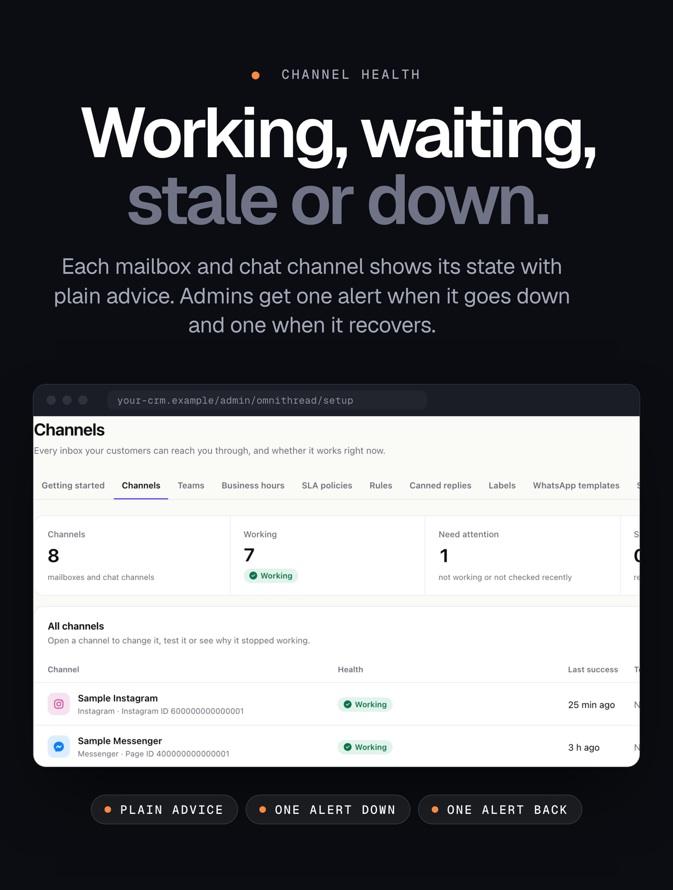
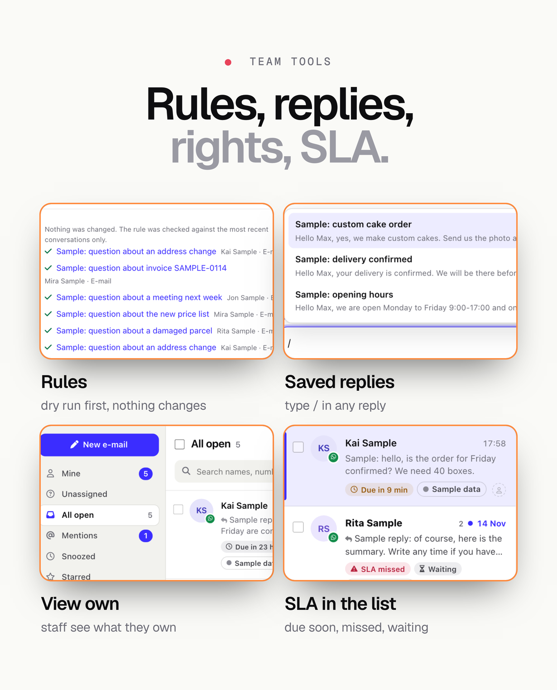

  

<h1 align="center">Omnithread</h1>

  <b>Omnichannel team inbox module for Perfex CRM.</b>

Perfex CRM module · shared team inbox · WhatsApp, Telegram, Messenger, Instagram, SMS & email

  <a href="https://omnithread-demo.mikodes.com/"><b>▶ Live demo</b></a> ·
  <a href="https://store.mikodes.com/p/omnithread/"><b>Get the full source code</b></a>

  
  
  
  

  

> **This repository is a showcase.** It holds screenshots, documentation pointers and a real excerpt
> from the code. The full application is sold as source code at
> **[store.mikodes.com/p/omnithread](https://store.mikodes.com/p/omnithread/)**: one payment, instant ZIP download, free setup help.

---

## What it is

E-mail, WhatsApp, Telegram, Messenger, Instagram, SMS and your own website chat in one shared team inbox inside Perfex CRM. The team claims conversations, answers within business-hours SLA and turns them into tickets, tasks or leads.

## Screens

 

 

 

## Features

- **Seven channel types in one inbox: e-mail, WhatsApp Cloud API, Telegram bot, Facebook Messenger, Instagram DM,…**: Customers write where they want.
- **E-mail mailboxes over IMAP and SMTP with the module's own socket clients**: Shared addresses such as support@ work on hosts where PHP's imap extension is gone.
- **Google and Microsoft 365 / Outlook.com sign-in for mailboxes: OAuth 2.0 with the buyer's own app, SASL…**: Connect Gmail / Workspace and Microsoft 365 mailboxes that no longer accept plain passwords.
- **Mail sync without duplicates: cron batches with UID, UIDVALIDITY and Message-ID tracking, threading by…**: No doubled inbox after an interrupted sync.
- **Safe e-mail reading: allow-list HTML sanitiser, sandboxed frame with a Content-Security-Policy, remote images…**: Opening a message cannot run scripts or track the reader.
- **WhatsApp Cloud API: signed webhook**: WhatsApp conversations in the CRM with Meta's reply-window rule handled for the agent.
- **Facebook Messenger and Instagram direct messages through Page webhooks: the same signature check, 24-hour…**: Social DMs land with the same team, rules and SLA as e-mail.
- **Telegram bot: webhook registered with a secret token from the Test connection button, private chats, text,…**: A free channel that needs no approval, connected in minutes.
- **Two-way SMS**: Answer text messages from the same inbox as e-mail and chats.
- **Website chat widget: one-line embed with the module's own script**: Visitors on any website start a conversation that the team answers from Perfex.
- **Webhook and delivery safety: a secret key in every webhook address, bodies over 1 MB refused, CSRF exemption…**: No duplicate messages and no silently lost replies - the top complaint about competing modules.
- **Channel health: ok, waiting, stale, down or disabled for every mailbox and chat channel, with plain-language…**: Know a channel stopped before customers complain.

## How it works

A technical case study of the architecture, one end-to-end flow, the key engineering decisions and how you would build something like this: **[docs/HOW-IT-WORKS.md](docs/HOW-IT-WORKS.md)**.

## A look at the code

Real excerpts from the source, shown for illustration:

- **Signed webhooks for WhatsApp, Messenger and Instagram** ([`snippets/MetaWebhook.php`](snippets/MetaWebhook.php)): Handles the verify-token handshake and the X-Hub-Signature-256 HMAC check shared by three Meta channels. Comparisons are constant-time and unsigned or malformed requests are refused before any message is parsed.
- **Reply approval that cannot be bypassed by editing** ([`snippets/ReplyApproval.php`](snippets/ReplyApproval.php)): A draft submitted for approval is fingerprinted (recipients, subject, body, attachments). If it changes afterwards, or the approver saw an older version, the approval is withdrawn and nothing is sent.
- **One-time satisfaction links** ([`snippets/CsatLink.php`](snippets/CsatLink.php)): A rating is requested by a link sent on the conversation's own channel. Only a hash of the token is stored, links expire, and the answer is accepted once even if two requests arrive at the same moment.

## Requirements (full version)

- Perfex CRM 3.2 or newer
- PHP 8.1 or newer with openssl, mbstring and curl
- MySQL or MariaDB
- The Perfex cron job, every 5 minutes
- Your own accounts for the channels you use

Not included: Perfex CRM itself; Hosting, domain, HTTPS certificate and the mailboxes themselves; Channel accounts and their fees: Meta; Meta App Review for Messenger / Instagram; AI provider usage.

## FAQ

**Is this the full source code?**  
No. This repository is a showcase with screenshots, a technical case study and real code excerpts. The complete Omnithread source code is sold at [store.mikodes.com/p/omnithread](https://store.mikodes.com/p/omnithread/).

**What is Omnithread built with?**  
Node.js, PHP, Perfex CRM.

**Can I try it before buying?**  
Yes, open the [live demo](https://omnithread-demo.mikodes.com/).

**Do I get help with the installation?**  
Free setup help is included with the store purchase; questions go to [mikodes.com/support](https://mikodes.com/support).

## Get the full source code

  

One payment, full licence, instant ZIP download and free setup help.
Questions: [mikodes.com/support](https://mikodes.com/support).

---

  Made by <a href="https://mikodes.com"><b>MIKODES</b></a> · <a href="https://github.com/Mikodesteam">more projects</a>

