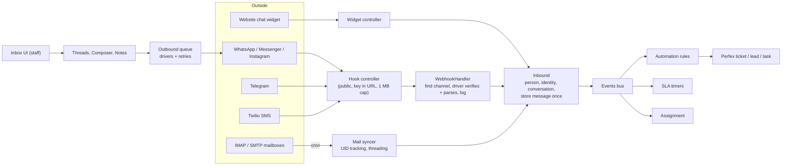

# How Omnithread works

A case study of a shared inbox that runs **inside** Perfex CRM as a module: e-mail, WhatsApp, Telegram, Facebook
Messenger, Instagram, SMS and website chat in one place, linked to Perfex customers, leads and tickets. It is
written from the real code; the excerpts linked below are verbatim pieces of it. The complete module is not in
this repository.

## The problem

Teams that run their business in Perfex CRM talk to customers on seven different surfaces, and none of them land in
the CRM as a conversation: a WhatsApp message lives on a phone, a mailbox lives in a mail client, a lead's Instagram
question is lost. A standalone helpdesk solves the inbox but is a second system with its own customers. Omnithread
puts the inbox inside the CRM so a message, the person who sent it, their invoices and their tickets are one click
apart, with team features (claiming, assignment, SLAs, internal notes, approval of replies) that small support teams
normally need a separate product for.

## Architecture

It is a Perfex module, so it follows Perfex's conventions (CodeIgniter 3, PHP, MySQL, its permission system and cron)
and keeps its own code in a namespace with its own tables prefixed `ot_`.

Main pieces under `libraries/Core`:

- **Channels**: one driver per channel type (parse a webhook, send a message, test the connection), a registry,
  and a store that holds each channel's settings, encrypted secrets and webhook key.
- **Conversations**: `Inbound` (store a customer message), `People` (one person across channels), `Outbound` and
  `Replier` (send).
- **Threads**: statuses, priorities, labels, snooze, merge, bulk actions with undo, presence ("a colleague is
  writing").
- **Automation, Sla, Teams, Csat, Stats/Reports**: rules, business-hours SLA timers, assignment strategies, ratings
  and aggregated reports.
- **Crm and Tickets**: the bridge to Perfex (link a person to a contact, customer or lead; create leads, tickets,
  tasks; two-way ticket replies).
- **Ai**: optional assistant on the buyer's own key. It is off by default and the model never sends anything.

## One flow end to end: an incoming WhatsApp message becomes a claimed conversation and a ticket

1. **The request arrives** at `/omnithread/hook/in/<accountId>-<key>`. There is no staff session, so two things decide:
   the key in the URL (looked up by the channel store, and a request for an unknown account or key gets 404 and no
   log row, so noise cannot fill the log) and the channel's own signature.
2. **Size and verification.** The controller refuses a body over 1 MB without parsing it. For WhatsApp, Messenger and
   Instagram the shared Meta check handles the verify-token handshake (GET) and the `X-Hub-Signature-256` HMAC (POST)
   with constant-time comparisons ([excerpt](../snippets/MetaWebhook.php)). Anything unsigned or malformed is
   rejected before any message is parsed.
3. **Parsing.** The driver turns the payload into neutral objects: inbound messages (text, media, location, button
   replies) and status updates (sent, delivered, read). A delivery report only moves a message's status forward.
4. **Store once.** `Inbound::ingest` first looks for the same external message id on the same account; if it exists the
   duplicate counter goes up and nothing else happens. Otherwise attachments are downloaded **before** the transaction
   (so no lock is held during HTTP), then the message is stored inside a transaction guarded by a named lock per
   account and sender. The check is repeated inside the lock, so two deliveries of the same message that arrive at the
   same moment cannot create two rows.
5. **Person and conversation.** The sender's identity on that channel is resolved to a person (and, by e-mail or a
   normalised phone number, linked to a Perfex contact, customer or lead). The open conversation of that identity on
   that account is reused; a conversation closed less than a configured number of days ago is reopened; otherwise a
   new one is opened with the channel account's default team.
6. **Events.** `Inbound` emits `conversation.created` and `message.inbound` on a small in-process event bus. A
   listener that throws is logged and does not stop the others, and a depth limit stops rule loops.
7. **Rules and assignment.** Automation rules (trigger, conditions on channel, text, customer group, business hours
   and so on, ordered actions) run. A rule can assign by round robin or fewest open conversations among available team
   members, set priority or labels, send an auto-reply (once per conversation and rule) or create a ticket.
8. **Claim.** A staff member sees the conversation in the inbox (views such as unassigned or mine), claims it, and
   others see who has it open or is writing.
9. **Reply under the rules of the channel.** For WhatsApp the 24-hour window is enforced: free text inside the window,
   approved templates outside it. A staff reply is queued and sent by the driver, with retries after 1, 5, 15, 60 and
   240 minutes and a manual retry. If the staff member needs approval, the draft goes through
   the approval flow ([excerpt](../snippets/ReplyApproval.php)).
10. **Ticket.** "Create ticket" opens a Perfex ticket with the conversation so far (capped at the last 50 messages and
    a character limit) and links both ways: new customer messages become ticket replies, and replies a staff member
    writes in the Perfex ticket are sent back out on the channel from the cron job. A reply is marked seen
    **before** it is sent so it can never go out twice; one the channel cannot take now is skipped and its author is
    notified.
11. **Close and rate.** Closing can send a satisfaction link ([excerpt](../snippets/CsatLink.php)); a low score can
    reopen the conversation.

## Key engineering decisions

### 1. Build inside Perfex instead of next to it

*Chosen:* a Perfex module that reuses its staff, permissions, customers, tickets and cron, and adds twelve
capabilities of its own. *Alternative:* a standalone app that syncs with Perfex over an API. *Why:* buyers already
manage people and rights in Perfex; a second user directory would drift. The price is working within Perfex's
conventions, which is why the code keeps a thin `Perfex/` layer next to a separate `Core/` that talks to the database through its own
small abstraction (`Db`) and has its own unit tests.

### 2. Idempotent ingestion

*Chosen:* a unique message identity per account, checked before and again inside a lock and transaction; delivery
failures answer 500 so the platform retries, and the retry is recognised. *Alternative:* acknowledge everything and
hope. *Why:* Meta, Telegram and Twilio all deliver at least once. Duplicates are normal; double conversations are
a bug the customer sees.

### 3. A webhook log that can replay, without storing secrets

*Chosen:* every accepted request is logged with a short summary; only the headers a replay needs are stored
(content type, user agent and the signature headers, which are bound to their own body); shared secrets and cookies are
never stored, and the URL is kept without its key. A replay runs the driver's check again, so it is refused if the
channel's secret has changed, and a request that failed its check is never replayed. *Alternative:* no log, or a raw
dump. *Why:* debugging channel setup is most of the support burden; a raw dump would store credentials.

### 4. Own IMAP/SMTP clients and OAuth instead of the PHP imap extension

*Chosen:* socket-based IMAP and SMTP clients in the module, with SSL/TLS or STARTTLS and XOAUTH2 for Google and
Microsoft, tracking UID, UIDVALIDITY and Message-ID so a mailbox is synced without duplicates. *Alternative:* the
`imap` extension, which many shared hosts do not have and which is deprecated in recent PHP. *Why:* the module should
install on the hosting Perfex users actually have.

### 5. AI that drafts and suggests but never sends

*Chosen:* optional, off by default, on the buyer's own provider key. A reply draft is put into the editor; label and
priority suggestions go to an approval queue unless the administrator allows automatic application; calls are limited
per month and per staff member, and the log of AI calls is hash-chained with a verify check. *Alternative:* an
autonomous auto-responder. *Why:* a wrong answer sent in a company's name costs more than a few clicks saved.

## Security and safety measures that exist in the code

- **Webhook security:** key in the URL, signature per channel (HMAC SHA-256 for Meta, Twilio's signature, Telegram's
  secret-token header), 1 MB body cap, CSRF exemption limited to the hook, widget and rating paths, and security
  headers (`nosniff`, `no-store`) on the response.
- **Secrets at rest:** mailbox passwords, channel tokens and the AI key are encrypted with AES-256-GCM using a key
  file kept outside the database, so a copy of the table alone reveals nothing. A wrong key makes decryption return
  nothing, never garbage.
- **SSRF guard:** mail-server addresses are checked against private and cloud-metadata ranges.
- **Safe e-mail rendering:** HTML is passed through an allow-list sanitiser and shown in a sandboxed frame with a
  Content-Security-Policy; remote images are blocked until the staff member chooses to show them; risky attachment
  types are never shown inline.
- **Permissions:** twelve capabilities including reply-with-approval and approve; mailboxes shared with chosen staff
  and roles; "view own" restricts inbox, search, reports and AI to assigned conversations; customer panels respect the
  staff member's Perfex rights.
- **Approval integrity:** an approved draft is exactly the one the approver saw (fingerprint, constant-time compare).
- **Ratings:** only a hash of the one-time token is stored; links expire; one answer per link.
- **Website chat:** allowed sites list, rate limit on new chats, consent text, and a transcript sent only after the
  visitor's address is confirmed.
- **Privacy tools:** export everything about one person and erase a person.
- **Clean lifecycle:** installing twice keeps data; uninstall removes the module's tables, options, files and key
  and leaves Perfex data and mail on the servers untouched.

## How you would build something like this

1. **Model the domain before the channels:** person, identity (one per channel), conversation, message, and a rule
   that a message is unique per account and external id. Write this as plain PHP with its own tests, no framework.
2. **Define a channel driver interface** (verify and parse a webhook, send, test connection, what the channel allows
   right now) and implement the simplest channel first. Everything channel-specific, such as WhatsApp's 24-hour window,
   belongs in the driver.
3. **Make ingestion idempotent** with unique keys, a lock and a transaction, and answer errors so platforms retry.
4. **Add an event bus** so rules, SLA and assignment react to conversations without the conversation code knowing
   about them. Put a depth limit on it from the first day.
5. **Add the inbox UI on top of a threads service**, not directly on tables; permissions are enforced in that
   service so every screen inherits them.
6. **Bring in the CRM bridge** (link people, create tickets) through a small adapter, and keep the Perfex-specific code
   in one folder.
7. **Add automation, SLA with business hours and reports** after the data is trustworthy; compute reports from
   pre-aggregated daily tables.
8. **Add AI last**, as suggestions behind approval, with limits and a log.

## Deployment and customization

Omnithread is installed from a ZIP through Perfex's module manager and activated; it needs a PHP version supported by
your Perfex, `openssl`, `mbstring`, `curl` and socket streams, a working Perfex cron, and a public HTTPS address for
webhooks and the chat widget. A built-in System check page verifies these, and a one-click sample-data button makes
a demo without firing any events. Channels are configured one by one (each shows its webhook address and a health
state). Things people customize: channel accounts, teams and assignment, business-hours calendars and SLA policies,
automation rules, saved replies and templates, labels, the CSAT message, the AI provider and limits, and the language
files. Styles load only on module pages and are scoped so Perfex's own look is untouched.

Full source code, docs and setup help: https://store.mikodes.com/p/omnithread/
